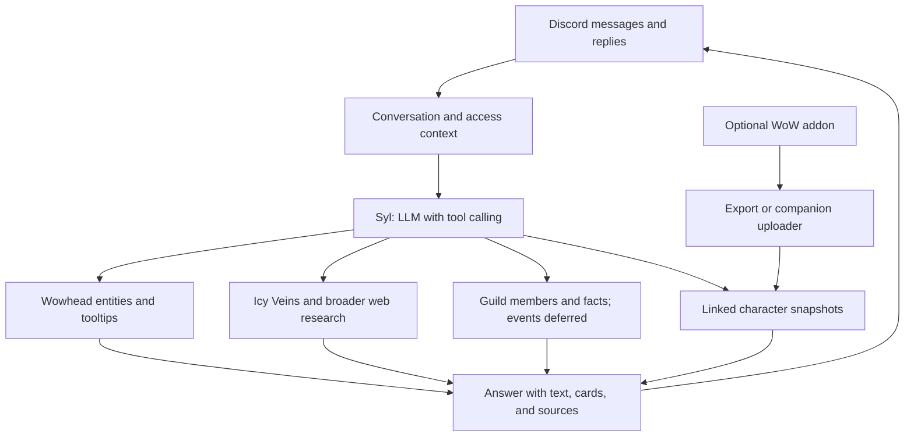

# Syl: product direction and architecture

Status: product direction established on November 4, 2026. The first conversational implementation now includes OpenAI Responses tool calling, mention/reply handling, existing Wowhead tooltips, source-filtered/broader web research, Discord member prefix lookup, and explicit memory commands. See README for implemented limits and deployment requirements. The remaining architecture and acceptance targets below include future work and do not imply those capabilities are deployed.

Implementation defaults: `gpt-6-luna` for conversation/lookups/final formatting, `gpt-6.1-sol` for public web research, both with low reasoning effort; six recent exchanges per member/channel, expiring after 30 minutes of inactivity; SQLite explicit facts saved only through `/remember`, inspected through `/memories`, and deleted through `/forget`. `/resetcontext` clears ephemeral context. Facts are member/channel scoped and may inform public replies there. Source research gets a separate public game query, with no history or fact records; the query's exclusion of personal details is model-instructed. Calendar, addon ingestion, character links, shared guild facts, exhaustive gear filtering, and full roster pagination remain future work. Live Frostbolt and sourced rogue research checks passed; automated checks cover core boundaries.

## Current understanding

Syl is an LLM-powered guild companion who participates in Discord conversations. Members can ask naturally for a spell tooltip, gear advice, dungeon preparation, raid information, or a question that requires several sources. Syl uses the conversation, verified game information, and authorized guild context to answer at the appropriate level of detail.

The goal is to make a knowledgeable, useful participant in the guild. Slash commands remain useful shortcuts and administrative controls; the primary interface becomes conversation.

The user's requirements are:

- Name the companion Syl.
- Use OpenAI as the LLM provider.
- Use GPT-6 Luna for conversation and lookups, and GPT-6.1 Sol for web research, both with low reasoning. Never use Astra due to cost; enforce this in application configuration and do not add an Astra fallback or escalation path.
- Support ordinary conversation and both straightforward and complex questions.
- Initially respond only to direct mentions of Syl or Discord replies to Syl's messages. Do not initiate conversations or respond automatically in a dedicated channel.
- Put public answers in Discord threads: create one from a main-channel message, reuse an existing thread, and keep lookup cards and follow-ups there. Slash-command acknowledgments and administrative/memory confirmations are private. Never fall back to public main-channel answers when threading fails. Recent context and personal saved facts remain scoped to the reply thread; guild defaults apply across the server.
- Remember explicitly saved facts and preferences across conversations, and use bounded recent context for follow-ups. Do not automatically convert casual conversation into long-term memories.
- Prefer Wowhead and Icy Veins for game information, and search more broadly when necessary.
- Understand guild members. Keep events and raids in the product vision, with integration and ownership explicitly deferred.
- Start optional in-game integration with character level, currently equipped gear, and talents. Capture snapshots at login and relevant changes; continuous tracking is not required.
- Keep WoW Forever as the default game context. Explicitly distinguish other versions when discussing them.

## Experience

| Member says | Syl should do |
| --- | --- |
| “What's Frostbolt?” | Resolve the Forever spell and send the existing tooltip card with its source. Use character context to choose a rank when available; otherwise label the displayed rank and offer alternatives. |
| “What's rogue BiS at level 25?” | Determine the relevant build and playstyle, retrieve eligible gear and current guidance, explain recommendations by slot, and disclose assumptions and missing data. |
| “List all hunter-relevant gear from Gnomeregan.” | Retrieve known dungeon drops and associated quest rewards, check usability and relevance, and return a browsable list with sources and coverage limits. |
| “What about daggers?” | Continue the same discussion with its class, level, faction, and game version intact. |
| “When's our next raid, and who is healing?” | Read the authoritative event and signup records, distinguish confirmed assignments from interest, and use Discord timestamps for the event time. |
| “What should I farm before that raid?” | Combine the event, the member's linked character snapshot, current gear, and available upgrade sources. State when the snapshot was collected. |
| Casual chat | Respond naturally and briefly without forcing a search or dumping item cards. |

“Can answer complex questions” means Syl can investigate, combine evidence, ask a useful clarification, and acknowledge when evidence is insufficient. It is not a promise that every question has a verified answer. Long research should produce a brief progress acknowledgment followed by the useful result, without flooding the channel.

Personality: brief, direct, and knowledgeable. Default to the shortest complete answer, without flavor text, roleplay, banter, related information, or unsolicited follow-up offers. Expand when requested or needed to answer fully. Keep essential assumptions, uncertainty, and source links concise; do not duplicate tooltip cards in prose.

Every conversational example above assumes a direct mention or a reply to a message from Syl. Reply detection uses the referenced message's author, including replies with mention notifications disabled. Merely typing the name “Syl,” mentioning a role, or participating in the same thread does not trigger a response. Existing explicit slash commands remain available. Raid examples describe future behavior pending the event/calendar decision.

## Decision tree

1. **Identity and purpose — resolved:** Syl, a conversational companion for the WoW Forever guild.
2. **Participation — resolved:** direct mentions and replies to Syl only. No proactive participation or channel-wide automatic responses. Existing explicit commands remain supported.
3. **Guild sources — calendar decision explicitly deferred:** use Discord for membership and roles. Future events may come from Discord Scheduled Events, a maintained calendar, or purpose-built internal database/calendar tooling. None is selected or required for the initial conversational release.
4. **Memory — resolved:** explicitly saved facts/preferences plus bounded recent conversation context. Do not extract permanent facts automatically from casual chat. Structured source sync, including opted-in character snapshots, is independent of conversation memory. Retention duration and the save/correct/forget interface remain implementation details to settle. Event reads/writes, signup changes, unsolicited reminders, and member pings remain deferred with the calendar feature.
5. **Runtime services — provider resolved:** use OpenAI for the LLM. Recommend the Responses API with function tools and OpenAI's built-in web search. Keep the exact model configurable; model selection, hosting, and operating-cost limits remain to be settled. Do not assume that credentials available to the coding assistant are available to the deployed bot.
6. **Optional character data — scope resolved, transport to validate:** character level, equipped gear, and talents. Capture at login once data is available and refresh on relevant changes. Snapshots are sufficient; no continuous feed is required. Recommend an automatic companion uploader for disk snapshots, with explicit export/upload as an alternative. Validate the Forever APIs and capture-to-upload latency before promising updates at each login.

Participation, memory behavior, the initial character-data scope, and the OpenAI provider choice are settled. Keep the event/calendar branch deferred until the user reopens it. Remaining deployment decisions include model/API access, cost limits, and hosting. Retention periods and memory controls also remain to be specified. Proposed defaults are not silently treated as approved.

## Architecture

Use one TypeScript service with clear modules and a persistent database. Keep discord.js and the existing Wowhead integration. A separate collection of microservices or multiple autonomous agents is unnecessary for the current guild-scale scope.

**Discord conversation adapter.** Gate messages before invoking the model: accept direct user mentions of Syl and replies whose referenced message was authored by Syl. Resolve reply/thread context, author identity, channel, guild, and permissions. Do not require a mention notification on a reply. Ignore bot/webhook loops and ambient messages, deduplicate events, and serialize turns within a conversation. Reuse eligible conversation context when addressed again, but do not keep responding to subsequent unaddressed messages. Support a fast tooltip response and a longer research response within the same conversational interface.

**Syl agent.** Use a tool-calling LLM that can compose lookups, filtered queries, research, and guild retrieval as needed. Do not restrict questions to an enumerated list of hardcoded intents. Validate every tool's arguments and enforce access and resource limits in application code. Keep a direct entity/ID path for existing commands. A simple lookup should not require a multi-page research session.

**Tool layer.** Expose narrowly defined operations such as `search_entities`, `get_tooltip`, `find_gear`, `read_source`, `search_web`, `get_member`, `get_guild_facts`, and `get_character_snapshot`. Reserve `list_events` and `get_event_signups` for the deferred calendar integration; do not expose nonfunctional event tools. Implement source connectors independently from the model and Discord renderer. Do not give the model unrestricted SQL, filesystem, or arbitrary HTTP access.

**Persistent storage.** SQLite is a reasonable starting point for a single service. Store guild settings, Discord-to-character links, explicitly saved facts/preferences, snapshots, and source metadata as structured records. Use bounded recent conversation history/summaries for continuity; summaries must expire with the context they represent and must not silently become permanent memory. Add event records when the deferred calendar feature is designed. Adopt Postgres if hosting or concurrency requires it; a vector database is not required for the initial architecture.

**Responses.** Return normal Discord text, tooltip attachments, comparison tables, and result selectors as appropriate. Preserve links from claims to evidence. Show freshness and missing coverage when they affect the answer. Keep citations compact and useful rather than appending a large generic source list.

## OpenAI integration

OpenAI is the selected LLM provider. The recommended integration is the official TypeScript SDK and Responses API. Syl supplies bounded conversation context and authorized retrieved facts, receives function calls, validates and executes them in the service, and sends tool results back until there is an answer or the request limit is reached. The existing Wowhead lookup and tooltip renderer become callable tools.

Use OpenAI's built-in `web_search` as the proposed research backend. Domain filters allow a first pass over Wowhead and Icy Veins; broader research can remove that restriction when the preferred sources are insufficient. Preserve returned citation annotations as clickable Discord links. Run public research with game-related query context, excluding private guild facts; combine the resulting evidence with authorized guild context in Syl's answer step.

Configure conversation with `OPENAI_MODEL` (default `gpt-6-luna`) and public research with `OPENAI_RESEARCH_MODEL` (default `gpt-6.1-sol`); credentials remain in `OPENAI_API_KEY`. Luna selects tools and formats the final Discord answer; Sol performs the isolated web research. Both settings reject Astra models. Model usage is logged without message bodies, and iterations, research calls, time, and response lengths are capped; see README for exact defaults. Explicit memories live in the application's SQLite database.

These settings now enable conversational behavior when a key is present and the required Discord intents are enabled. API credentials must be provided to the deployed service separately and must not appear in chat, source control, or the addon.

## Game knowledge and research

Use Wowhead for entity identity, tooltip/stat records, loot, and quest relationships. Use Wowhead and Icy Veins for authored guidance. Icy Veins has a dedicated Forever section; this does not establish that every class, level, or gear question has a complete guide.

Search broadly when preferred sources are incomplete, unavailable, stale, or conflicting. Blizzard announcements, patch notes, and other relevant primary sources can resolve conflicts; community material may provide additional evidence with clear attribution. Page contents and search snippets are evidence, never instructions to the agent.

Track source URL, game version, relevant build/date, retrieval time, and whether a statement is a game fact, guide recommendation, calculation, or inference. Verify game version before merging evidence. Existing Forever-only lookup behavior remains the default; a Classic guide is not silently treated as a Forever guide.

For gear advice, use structured records and explicit eligibility checks for required level, class/proficiency, faction, slot, acquisition requirements, and source. Recommendations may use current guides and explainable scoring. Treat weapon behavior, procs, and set interactions separately where a simple stat score is inadequate. Label estimates and assumptions. Do not claim exhaustive BiS or all dungeon loot when the underlying source coverage is incomplete.

Persist useful retrieved records and refresh them by source and freshness requirements. A name-search endpoint capped at 25 results cannot establish a complete item universe. The gear query tool needs a separately verified collection/filter strategy, pagination, and coverage tracking. Respect upstream rate limits and fail clearly when a source blocks access.

## Guild knowledge

Discord users and game characters are different entities. Link them explicitly, allow multiple characters, and store class, spec, level, faction, and preferred character with provenance. A Discord nickname alone does not verify a character's ownership or current build.

Use Discord membership and roles for the server roster. Obtain in-game guild membership from an explicitly supported source or uploaded observations; do not equate every Discord member with an in-game guild member. Fetch/paginate membership as needed rather than assuming the client cache contains everyone.

Event/calendar design is intentionally deferred. The eventual source could be Discord Scheduled Events, a calendar someone maintains, or the project's own internal database/calendar tooling. Keep calendar access behind a replaceable integration boundary without building an event system yet. When implemented, identify the authoritative source and preserve cancellation, timezone, and last-sync information. Discord event interest alone must not be treated as confirmed attendance, character selection, or a role assignment. Until a source is configured, Syl should say that guild event data is not connected.

Store explicitly saved guild facts and member preferences separately from recent conversation context. Every saved fact needs an owner/source, scope, timestamp, and a correction/deletion path. Saving a member's preference and updating a shared guild rule have different permissions; define the permitted editors before exposing the save tool. Casual statements can inform the current conversation without becoming permanent facts. Read channel history only within the agreed context and retention policy; do not assume all Discord history is a knowledge base. Opted-in character snapshots remain automatically synchronized structured data, rather than inferred conversational memories.

Scope every retrieval to the guild, requesting member, and intended reply audience. Information from an officer channel or private conversation must not be surfaced in a channel whose audience cannot access it. Check permissions before supplying context to the model, and recheck on later turns. Public web search queries should contain game terms, not internal guild discussions or member details. Provider choice must account for the private context sent to the LLM.

## Optional in-game information

Treat this as an opt-in source with its own authenticated ingestion contract. The practical design is:

`WoW addon → saved snapshot or explicit export → desktop uploader/manual upload → Syl ingestion API → linked character record`

Capture and delivery are separate stages. At login, collect the player's level, equipped items, and talents once the client has populated them. Refresh the in-memory snapshot after level, equipment, or talent changes, debounce bursts of events, and handle initially unavailable item data without overwriting good values with empty slots.

An addon does not have a general HTTP client for posting these snapshots directly to Syl. Wowhead documents a comparable addon-plus-desktop-client approach. With a SavedVariables-based bridge, WoW normally writes the updated snapshot on UI reload, logout, or exit; the uploader can then send it automatically. Merely logging in does not guarantee that the new snapshot is immediately on disk, and an uploader at login may see the previous session's snapshot. Do not force a UI reload or imply that capture time and upload time are the same. An explicit export/upload is an alternative. Validate actual Forever client behavior before specifying the sync timing.

Initial snapshot fields are character identity and game version/build, level, equipped items by slot, and selected talents/ranks or an equivalent build representation supported by the client. Preserve item-instance details such as enchantments or random affixes when available; item IDs alone may not fully describe the equipped gear. Character class is needed to interpret the data. Professions, bags, bank, combat logs, raid lockouts, and other members' gear are outside the initial addon scope. Validate the available APIs against Forever before choosing event names or a serialization schema.

This is opt-in snapshot synchronization, not a continuous telemetry stream. Show when the character state was captured and last uploaded. Do not infer that a member is currently online just because a snapshot arrived.

Every upload should carry schema version, game build, character identifier, collection timestamp, and uploader identity. Bind uploads to an authenticated Discord account and an explicit character link; mark ownership verification limits. Check size/types and parse a restricted data format rather than executing uploaded Lua. Support stale-data indicators, replacement, unlinking, and deletion. Never place the Discord bot token or LLM key in the addon.

## Engineering changes from today's bot

- Retain `src/wowhead.ts`, `src/model.ts`, and `src/tooltip.ts` as the initial lookup tools and renderer.
- Extract reusable tool functions from slash-command orchestration in `src/bot.ts`; add a conversation adapter and model tool loop.
- Extend `src/index.ts` with message handling gated on direct mentions/replies. The current bot subscribes only to `Guilds` and cannot read ordinary channel conversations or maintain the full member roster.
- Add model/search credentials, persistent storage, context assembly, source adapters, and per-request usage limits. Keep secrets out of logs and Git, as today.
- Add guild/member adapters and explicit character linking. Keep conversation memory separate from source records and structured guild facts. Defer event adapters and calendar writes.
- Provide a continuously running deployment for the Discord gateway and any ingest/refresh work. The current local process stops being available when its host sleeps or exits.

Discord lists `MESSAGE_CONTENT` and `GUILD_MEMBERS` as privileged intents. Access must match the chosen behavior and be enabled in the Developer Portal where required; code changes alone do not grant it. Verify content availability for direct mentions and replies with mention notifications disabled before selecting the final intent set. Request no event-management or presence access for the initial scope.

## Delivery and acceptance

The implementation target is an integrated conversational Syl with game research and guild/member context. Work can be built in dependency order: shared tools and storage, conversation/model loop, research and gear retrieval, then guild/member integrations. Character snapshots have a defined initial scope but depend on validating client access and a distribution/upload approach. Event/calendar integrations remain deferred by user decision and do not block the initial conversational release.

Acceptance scenarios should include:

- Syl answers direct mentions and replies to her messages, including replies with mention notifications disabled. Ambient chat, role mentions, plain-text use of “Syl,” and unaddressed thread messages do not trigger her.
- A member asks for Frostbolt and receives a source-backed card with an explicit rank/version.
- A level-25 rogue question produces explained recommendations, respects equipment/acquisition limits, and cites evidence or clearly labels estimates.
- A follow-up retains the appropriate class/level context without confusing another member's character.
- An explicitly saved preference survives later conversations and can be corrected or forgotten. An unsaved casual statement is not retained beyond the recent-context policy. Character sync continues independently of this memory policy.
- A dungeon gear query returns known matches with coverage/freshness information and working pagination.
- Before calendar integration, a raid question clearly reports that guild event data is not connected. Future calendar acceptance includes authoritative schedules/signups, interest versus assignments, and canceled events.
- Private guild context remains restricted to its authorized audience, including after a role change.
- Source outages, conflicting versions, unavailable character data, and expired snapshots produce useful explanations rather than invented facts.
- Guild administrators can configure participation channels and memory behavior; request limits prevent repeated replies or unbounded research.
- Optional addon uploads are attributed to the correct member and safely reject malformed, stale, or unsupported payloads.
- Logging in captures level, equipment, and talents after client data is ready. A reload/logout persists the snapshot for an automatic uploader; the stored capture and upload timestamps remain distinct. No claim of instant login delivery is made without verifying a supporting transport.

## Sources checked

- [Discord Gateway and privileged intents](https://docs.discord.com/developers/events/gateway)
- [Discord Scheduled Events API](https://docs.discord.com/developers/resources/guild-scheduled-event)
- [Wowhead Forever database](https://www.wowhead.com/forever/database)
- [Wowhead Forever item filters](https://www.wowhead.com/forever/items)
- [Wowhead Client: addon collection and desktop uploads](https://www.wowhead.com/client)
- [Icy Veins Forever guides](https://www.icy-veins.com/wow-forever/)
- [OpenAI Responses API function calling](https://developers.openai.com/api/docs/guides/function-calling)
- [OpenAI web search and domain filtering](https://developers.openai.com/api/docs/guides/tools-web-search)

Checked November 4, 2026. These sources establish current integration surfaces, not guaranteed endpoint stability or complete Forever data coverage.
